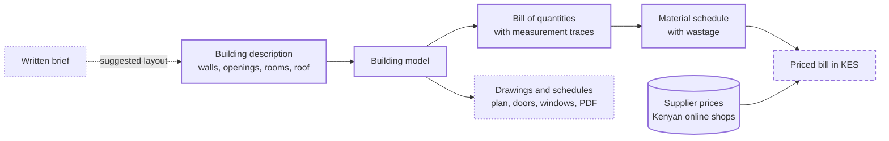

# DesignSynapse

Quantity takeoff and material pricing for houses in Kenya, computed directly from the building design.


DesignSynapse turns a description of a building into a bill of quantities (BOQ) and a material schedule, and is adding supplier prices in Kenyan shillings. Every quantity is measured from the building's geometry and records how it was measured, so the professional reviewing it can check each line.

It is built to work alongside architects and quantity surveyors, not to replace them. The software does the repetitive measuring; the professional keeps the judgement and the sign-off. A tractor instead of a jembe.

## Why

Costing a house in Kenya passes through several hands. An architect draws it, a quantity surveyor measures the drawings into a bill of quantities, prices come from calls to hardware stores, and the contractor works from the result. Much of that is repetitive measuring and re-pricing done by hand, and it has to be redone whenever the design changes.

DesignSynapse keeps one building model and derives everything else from it. Change a wall, and the quantities, the material list and, once pricing lands, the cost change with it.

It is aimed at two groups:

- **Quantity surveyors, architects and contractors**, who get a traceable first-pass bill to check and adjust instead of measuring from scratch.
- **Homeowners and small developers**, who get a clear picture of what a design needs, to take to a professional.

## What it does today

DesignSynapse is currently a Python library. A web app is on the roadmap.

- **Building model.** Single-storey masonry houses: walls drawn on their centrelines, doors and windows, rooms, strip foundations, ground slab, ring beam, and gable or hip roofs. Input is validated: external walls must close into a loop, and openings must fit within their walls.
- **Quantity takeoff.** A bill in ten sections, from substructure to painting, measured by the centreline (girth) method. Each item records how it was measured.
- **Material schedule.** Converts the bill into what is actually bought, with wastage: bags of cement, tonnes of sand and ballast, stones, roofing sheets and steel bars.
- **Price collection.** Snapshots prices from the public catalogues of three Kenyan online building-supply shops: about 1,600 products on the first run in November 2026.

> [!IMPORTANT]
> The default rate table behind the takeoff is **unverified** until a practising quantity surveyor has reviewed it. Treat the quantities as a first pass for a professional to check.

## How it works



Solid outline: built. Dashed: in progress. Dotted: planned.

- **One model, everything derived.** The building model is the single source of truth. Quantities, materials and prices are computed from it, never re-typed.
- **Deterministic quantities.** The same design always gives the same bill. AI will only ever suggest layouts; it does not produce quantities or prices.
- **Rates are data, not code.** Specifications, material constants (stones per m², bags of cement per m³ of concrete) and wastage live in a TOML rate table, [`kenya_default.toml`](apps/platform/src/designsynapse/quantities/rate_tables/kenya_default.toml). A quantity surveyor can review and change it without touching the code.
- **Nothing is guessed.** A building the takeoff does not yet support raises an error instead of an estimate, and a material with no matched supplier price is reported as unpriced.

## Example

The test suite takes off a 10 × 8 m two-room bungalow: 200 mm external stone walls, a 150 mm partition, two doors, three windows and a 25° gable roof. The result is a 38-item bill in ten sections and a 32-line material schedule. An excerpt:

| Item | Description | Unit | Qty | Measured as |
|---|---|---|---:|---|
| A2 | Excavate foundation trench not exceeding 1.5 m deep | m³ | 26.04 | external walls 36.00 m × 0.6 × 1.0 = 21.60; internal walls 7.40 m × 0.6 × 1.0 = 4.44 |
| A12 | Concrete class 20 (1:2:4) in 150 mm ground floor slab | m³ | 11.29 | inside external walls 76.44 m² − internal wall footprint 1.17 m² = 75.27 m² × 0.15 |
| B2 | Y12 main bars in ring beam | kg | 155.73 | 43.80 m × 4 bars × 0.889 kg/m |
| C1 | 200 mm machine-cut stone walling in cement-sand (1:4) mortar | m² | 94.59 | external walls 36.00 m × 2.8 high = 100.80, less openings 6.21 |
| D1 | Gauge 30 box profile roofing sheets, measured on slope | m² | 118.24 | plan 11.40 × 9.40 = 107.16 m² ÷ cos 25° |
| G1 | 12 mm cement-sand (1:4) plaster to internal walls | m² | 141.93 | Living 27.25 m × 3.00 − openings 5.01; Bedroom 23.25 m × 3.00 − openings 4.56 |

The material schedule turns those items into what you would buy, with wastage:

| Material | Unit | Qty |
|---|---|---:|
| Portland cement 32.5N (50 kg) | bag | 200.2 |
| River sand | t | 33.7 |
| Ballast 20 mm | t | 25.6 |
| Machine-cut stone 400 × 200 × 200 mm | pc | 1761.2 |
| Box profile roofing sheet, gauge 30 | m² | 136.0 |
| Y12 high yield bar, 12 m | pc | 15.3 |

Every quantity for this house is checked in [`test_takeoff_two_room_house.py`](apps/platform/tests/test_takeoff_two_room_house.py) against a hand calculation written out as arithmetic.

## Getting started

Requires Python 3.12 or newer.

```bash
git clone https://github.com/RonoHenry/Design-Synapse.git
cd Design-Synapse/apps/platform
python -m venv .venv
source .venv/bin/activate        # Windows: .venv\Scripts\activate
pip install -e ".[dev]"
pytest
```

### Take off a building

```python
from designsynapse.model import Building
from designsynapse.quantities import default_rate_table, takeoff


def wall(id, x1, y1, x2, y2):
    return {"id": id, "kind": "external", "thickness": 0.2,
            "start": {"x": x1, "y": y1}, "end": {"x": x2, "y": y2}}


studio = Building.model_validate({
    "name": "One-room studio, 5 x 4 m",
    "walls": [wall("S", 0, 0, 5, 0), wall("E", 5, 0, 5, 4),
              wall("N", 5, 4, 0, 4), wall("W", 0, 4, 0, 0)],
    "openings": [
        {"id": "d1", "wall_id": "S", "kind": "door", "mark": "D1",
         "width": 0.9, "height": 2.1, "offset": 0.6},
        {"id": "w1", "wall_id": "N", "kind": "window", "mark": "W1",
         "width": 1.5, "height": 1.2, "sill": 0.9, "offset": 1.75},
    ],
    "rooms": [{"name": "Studio", "floor_finish": "ceramic_tiles",
               "polygon": [{"x": 0.1, "y": 0.1}, {"x": 4.9, "y": 0.1},
                           {"x": 4.9, "y": 3.9}, {"x": 0.1, "y": 3.9}]}],
})

bill = takeoff(studio, default_rate_table())

walling = bill.item("walling.mcs_200")
print(walling.code, walling.description)
print(f"  {walling.quantity:.2f} {walling.unit}:", "; ".join(walling.trace))
print(f"Cement: {bill.material('cement').quantity:.1f} bags")
```

```text
C1 200 mm machine-cut natural stone walling in cement-sand (1:4) mortar
  46.71 m2: external walls 18.00 m x 2.8 high = 50.40; less openings 3.69 m2
Cement: 66.8 bags
```

Foundations, slab, ring beam and roof take default values when omitted. [`tests/conftest.py`](apps/platform/tests/conftest.py) shows a complete house with every setting spelled out.

### Collect supplier prices

```bash
cd apps/price-scraper
python -m price_scraper          # writes data/prices-YYYY-MM-DD.csv
```

The scraper reads each shop's public product feed over HTTPS, one request at a time. Shops are listed in [`stores.py`](apps/price-scraper/price_scraper/stores.py) after checking their robots.txt; sites that block automated access are left out.

## Roadmap

| Stage | Status |
|---|---|
| Building model | Done |
| Quantity takeoff and material schedule | Done; rate table awaiting review by a quantity surveyor |
| Supplier price collection from online shops | Done; sand, ballast, stone, steel, iron sheets and timber need another source |
| Priced bill in KES | In progress |
| Drawings and schedules: floor plan, door and window schedules, BOQ as PDF | Planned |
| Layout suggested from a written brief | Planned |
| Web app and deployment | Planned |

## The bigger picture

Delivering a house involves a site survey, design, architecture, engineering, quantities, materials, labour and project management. Today these sit with separate tools, firms and trades, and information is re-entered at every hand-off. The long-term aim is one project model that each stage reads from and adds to, with professionals doing the work that needs their judgement.

This repository holds early prototypes of several of those stages, from an earlier multi-service design. They are paused while the first chain, from design to a priced bill, is made to work end to end, and will be brought back one at a time.

| Stage | In this repository | State |
|---|---|---|
| Site survey and geodata | `.kiro/specs/survey-service` | Specification only |
| Design | `apps/design-service` | Prototype: AI-generated design specifications |
| Architecture and documentation | `apps/architectural-service` | Prototype, paused |
| Engineering checks | `apps/engineering-service` | Prototype, paused: structural, MEP and civil calculations |
| Quantities and materials | `apps/platform` | Active |
| Suppliers and pricing | `apps/price-scraper`, `apps/vendor-service` | Active; vendor catalogue prototype paused |
| Labour | `apps/labor-service` | Prototype, paused |
| Project delivery | `apps/project-service` | Prototype, paused |
| Building codes and standards | `apps/knowledge-service` | Prototype, paused |
| Accounts and access | `apps/user-service`, `apps/api-gateway` | Prototype, paused |

## Repository layout

```
apps/
  platform/            Building model, quantity takeoff and material schedule (active)
  price-scraper/       Supplier price collection (active)
  *-service/           Earlier FastAPI prototypes of other stages (paused, see above)
  analytics-service/   Placeholder (no code yet)
  frontend/            Placeholder for a web app (no code yet)
docs/                  Original product and design notes
.kiro/specs/           Feature specifications: requirements, design and tasks
```

## Development

- **Tests:** run `pytest` inside each active app. The takeoff tests compare every quantity with a hand calculation.
- **Checks:** formatting, linting and security scans run as pre-commit hooks (black, isort, flake8 with docstring rules, bandit). Install them with `pip install pre-commit` and `pre-commit install`.
- **Specifications:** features are written up in `.kiro/specs/` as requirements, design and tasks before they are built.

## Feedback

The most useful contribution right now is review from people who build. If you are a quantity surveyor, architect, contractor or builder in Kenya, please [open an issue](https://github.com/RonoHenry/Design-Synapse/issues): challenge an assumption in the [rate table](apps/platform/src/designsynapse/quantities/rate_tables/kenya_default.toml), or point out what a bill like the example above is missing.

## License

[MIT](LICENSE). Copyright (c) 2026 Henry Rono.
