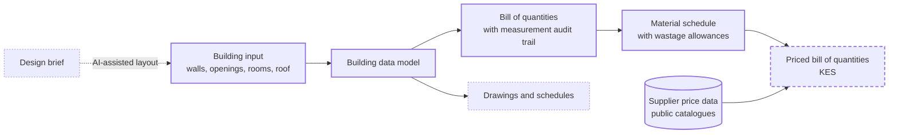

# DesignSynapse

**An integrated platform for the built environment, connecting design, cost management and procurement through a single building data model.**


DesignSynapse is a modern platform that bridges the fragmentation of the built-environment value chain. Design, measurement, cost planning and procurement are typically carried out by separate parties in separate tools and documents, and project information is re-keyed at every hand-off. DesignSynapse replaces those hand-offs with one structured building model from which every downstream deliverable is derived.

The first module delivers design-to-cost for residential construction in Kenya: automated quantity takeoff, material scheduling and supplier pricing, with every measured quantity traceable to its source geometry.

The platform is built to augment professional practice. It automates measurement and data handling, while design authority, professional judgement and certification remain with the architect and the quantity surveyor.

> [!IMPORTANT]
> The default rate table is pending review by a practising quantity surveyor. Until that review is complete, outputs should be treated as a preliminary takeoff for professional verification.

## The problem

Residential project delivery in Kenya depends on manual coordination between disciplines. Architectural drawings are measured by hand into a bill of quantities, material prices are obtained supplier by supplier, and estimates are rebuilt each time the design changes. The result is duplicated effort, slow feedback on the cost of design decisions, and project documents that drift out of step with one another.

## Approach

DesignSynapse treats the building model as the single source of truth. Quantities, material schedules and priced estimates are computed from the model rather than transcribed, so they remain consistent with the design through every revision.



*Solid outline: implemented. Dashed: in development. Dotted: planned.*

### Design principles

- **Single source of truth.** Every output is derived from one building model; nothing is re-keyed.
- **Deterministic and auditable.** Identical inputs always produce identical bills of quantities, and each item records how it was measured. AI is reserved for design assistance, such as layout suggestions, and is never used to produce quantities or prices.
- **Configuration over code.** Specifications, material constants and wastage factors are maintained in a version-controlled rate table, [`kenya_default.toml`](apps/platform/src/designsynapse/quantities/rate_tables/kenya_default.toml), which domain experts can review and adjust without modifying code.
- **Explicit scope.** Geometry outside the supported scope raises an error rather than an approximation, and materials without a verified supplier match are reported as unpriced.

## Capabilities

DesignSynapse is in early development and is currently distributed as a Python library. A web application is on the roadmap.

| Capability | Description | Status |
|---|---|---|
| Building data model | Object-based model of single-storey masonry buildings: centreline wall geometry, openings, rooms, strip foundations, ground-floor slab, ring beam, and gable or hip roofs, with geometric validation on input | Implemented |
| Quantity takeoff | Bill of quantities in ten sections, from substructure to painting, measured by the centreline (girth) method with adjustments at wall junctions; every item carries its measurement trace | Implemented |
| Material scheduling | Conversion of measured work into procurement quantities (cement, aggregates, masonry units, roofing and reinforcement) with configurable wastage allowances | Implemented |
| Supplier price data | Automated collection of building-material prices from public supplier catalogues in Kenya: about 1,600 products across three suppliers as of November 2026 | Implemented |
| Priced bill of quantities | Material schedule priced in KES against matched supplier products | In development |

### Intended users

| User | Value |
|---|---|
| Quantity surveyors and cost consultants | Automated preliminary takeoff with a full measurement audit trail, leaving review, adjustment and certification to the professional |
| Architects and designers | Rapid feedback on the quantity and material implications of design options |
| Contractors | Consistent material schedules for estimating and procurement |
| Clients and developers | A structured, traceable basis for engaging professionals |

## Example output

The reference test case is a 10 × 8 m two-room bungalow with 200 mm external stone walls, a 150 mm internal partition, two doors, three windows and a 25° gable roof. The takeoff produces a 38-item bill of quantities in ten sections and a 32-line material schedule.

Bill of quantities (extract):

| Item | Description | Unit | Qty | Measurement trace |
|---|---|---|---:|---|
| A2 | Excavate foundation trench not exceeding 1.5 m deep | m³ | 26.04 | external walls 36.00 m × 0.6 × 1.0 = 21.60; internal walls 7.40 m × 0.6 × 1.0 = 4.44 |
| A12 | Concrete class 20 (1:2:4) in 150 mm ground floor slab | m³ | 11.29 | inside external walls 76.44 m² − internal wall footprint 1.17 m² = 75.27 m² × 0.15 |
| B2 | Y12 main bars in ring beam | kg | 155.73 | 43.80 m × 4 bars × 0.889 kg/m |
| C1 | 200 mm machine-cut stone walling in cement-sand (1:4) mortar | m² | 94.59 | external walls 36.00 m × 2.8 high = 100.80, less openings 6.21 |
| D1 | Gauge 30 box profile roofing sheets, measured on slope | m² | 118.24 | plan 11.40 × 9.40 = 107.16 m² ÷ cos 25° |
| G1 | 12 mm cement-sand (1:4) plaster to internal walls | m² | 141.93 | Living 27.25 m × 3.00 − openings 5.01; Bedroom 23.25 m × 3.00 − openings 4.56 |

Material schedule (extract, including wastage):

| Material | Unit | Qty |
|---|---|---:|
| Portland cement 32.5N (50 kg) | bag | 200.2 |
| River sand | t | 33.7 |
| Ballast 20 mm | t | 25.6 |
| Machine-cut stone 400 × 200 × 200 mm | pc | 1761.2 |
| Box profile roofing sheet, gauge 30 | m² | 136.0 |
| Y12 high yield bar, 12 m | pc | 15.3 |

Each quantity in the reference case is verified in [`test_takeoff_two_room_house.py`](apps/platform/tests/test_takeoff_two_room_house.py) against an independent hand calculation.

## Quick start

Requires Python 3.12 or later.

```bash
git clone https://github.com/RonoHenry/Design-Synapse.git
cd Design-Synapse/apps/platform
python -m venv .venv
source .venv/bin/activate        # Windows: .venv\Scripts\activate
pip install -e ".[dev]"
pytest
```

### Running a takeoff

The example below models a 5 × 4 m single-room building and reports one bill item with its measurement trace.

```python
from designsynapse.model import Building
from designsynapse.quantities import default_rate_table, takeoff


def wall(id, x1, y1, x2, y2):
    return {"id": id, "kind": "external", "thickness": 0.2,
            "start": {"x": x1, "y": y1}, "end": {"x": x2, "y": y2}}


studio = Building.model_validate({
    "name": "One-room studio, 5 x 4 m",
    "walls": [wall("S", 0, 0, 5, 0), wall("E", 5, 0, 5, 4),
              wall("N", 5, 4, 0, 4), wall("W", 0, 4, 0, 0)],
    "openings": [
        {"id": "d1", "wall_id": "S", "kind": "door", "mark": "D1",
         "width": 0.9, "height": 2.1, "offset": 0.6},
        {"id": "w1", "wall_id": "N", "kind": "window", "mark": "W1",
         "width": 1.5, "height": 1.2, "sill": 0.9, "offset": 1.75},
    ],
    "rooms": [{"name": "Studio", "floor_finish": "ceramic_tiles",
               "polygon": [{"x": 0.1, "y": 0.1}, {"x": 4.9, "y": 0.1},
                           {"x": 4.9, "y": 3.9}, {"x": 0.1, "y": 3.9}]}],
})

bill = takeoff(studio, default_rate_table())

walling = bill.item("walling.mcs_200")
print(walling.code, walling.description)
print(f"  {walling.quantity:.2f} {walling.unit}:", "; ".join(walling.trace))
print(f"Cement: {bill.material('cement').quantity:.1f} bags")
```

```text
C1 200 mm machine-cut natural stone walling in cement-sand (1:4) mortar
  46.71 m2: external walls 18.00 m x 2.8 high = 50.40; less openings 3.69 m2
Cement: 66.8 bags
```

Foundation, slab, ring beam and roof parameters fall back to defaults when omitted. [`tests/conftest.py`](apps/platform/tests/conftest.py) defines a fully specified reference building.

### Collecting supplier prices

```bash
cd apps/price-scraper
python -m price_scraper          # writes data/prices-YYYY-MM-DD.csv
```

The collector reads each supplier's public product catalogue over HTTPS at a conservative request rate. Suppliers are registered in [`stores.py`](apps/price-scraper/price_scraper/stores.py) only after their robots.txt has been reviewed; sites that restrict automated access are excluded.

## Roadmap

- Review of the default rate table by a practising quantity surveyor
- Priced bill of quantities in KES, based on a reviewed mapping from supplier products to materials
- Price coverage for bulk materials not sold through online catalogues: aggregates, masonry, reinforcement, roofing sheets and timber
- Drawing production: floor plans, door and window schedules, and export of the bill of quantities to PDF
- AI-assisted layout from a written design brief
- Web application and hosted deployment

## Platform vision

The long-term objective is an integrated platform spanning the building lifecycle, from site survey and design through engineering, cost management, procurement, labour and project delivery, connected by a common project data model.

The repository contains early prototypes of several of these modules from a previous service-oriented architecture. They are paused while the design-to-cost chain is completed, and will be integrated one at a time.

| Lifecycle stage | Repository location | Status |
|---|---|---|
| Site survey and geospatial data | `.kiro/specs/survey-service` | Specification |
| Design | `apps/design-service` | Prototype (paused): AI-generated design specifications |
| Architecture and documentation | `apps/architectural-service` | Prototype (paused) |
| Engineering | `apps/engineering-service` | Prototype (paused): structural, MEP and civil calculations |
| Cost management | `apps/platform` | Active development |
| Procurement and pricing | `apps/price-scraper`, `apps/vendor-service` | Active development; vendor catalogue prototype paused |
| Labour | `apps/labor-service` | Prototype (paused) |
| Project delivery | `apps/project-service` | Prototype (paused) |
| Codes and standards | `apps/knowledge-service` | Prototype (paused) |
| Identity and access | `apps/user-service`, `apps/api-gateway` | Prototype (paused) |

## Repository structure

```
apps/
  platform/            Building data model, quantity takeoff and material scheduling (active)
  price-scraper/       Supplier price data collection (active)
  *-service/           Prototype modules from the previous architecture (paused)
  analytics-service/   Placeholder (no code yet)
  frontend/            Placeholder for the web application (no code yet)
docs/                  Original product and design documentation
.kiro/specs/           Feature specifications: requirements, design and implementation tasks
```

## Development

- **Testing:** run `pytest` within each active package. Takeoff tests assert every quantity against an independent hand calculation.
- **Quality gates:** formatting, linting and static security analysis run as pre-commit hooks (black, isort, flake8 with docstring rules, and bandit). Enable them with `pip install pre-commit` and `pre-commit install`.
- **Specification-driven development:** each feature is specified in `.kiro/specs/` as requirements, design and implementation tasks before it is built.

## Contributing

Domain review is the most valuable contribution at this stage. Quantity surveyors, architects, engineers and contractors working in Kenya are invited to [open an issue](https://github.com/RonoHenry/Design-Synapse/issues) to challenge an assumption in the [rate table](apps/platform/src/designsynapse/quantities/rate_tables/kenya_default.toml) or to identify items a professional bill of quantities would require.

## License

Released under the [MIT License](LICENSE). Copyright (c) 2026 Henry Rono.
